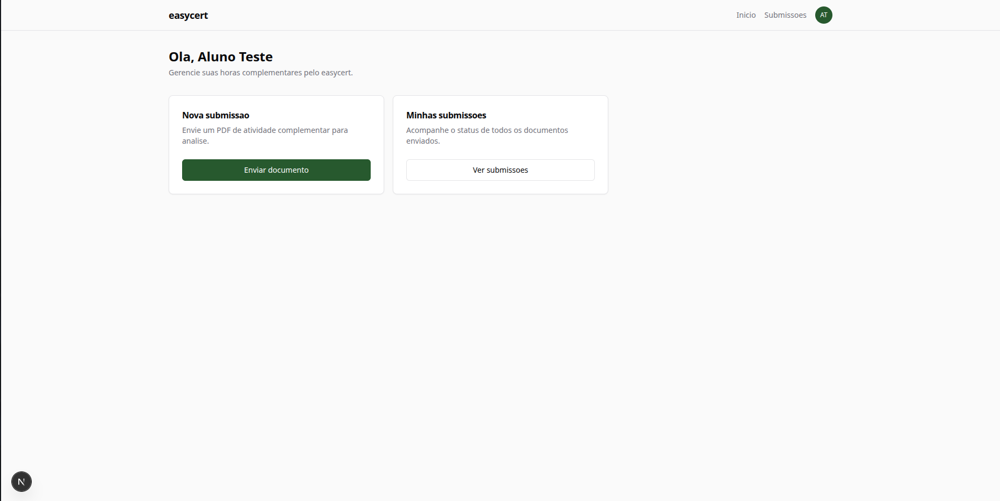
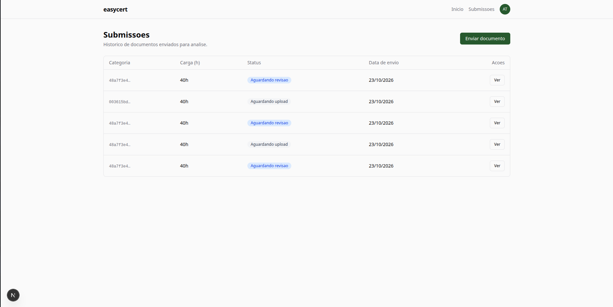

# TCC — Pré-banca (rascunho)

Esqueleto dos 14 slides da pré-banca, no formato do template `Muller_PreBanca_v2.pptx`. Conteúdo pronto para colar no PowerPoint. Lacunas marcadas `[FALTA: …]`.

---

## Slide 1 — Capa

> **Desenvolvimento de uma Plataforma Web para Gestão de Horas Complementares e Automação de Fluxos Acadêmicos Baseada em Desenvolvimento Acelerado**
>
> Discente: Pedro Henrique Teixeira
> Orientador: Prof. Robson Leandro Carvalho Canato

## Slide 2 — Instituição

> GRADUAÇÃO EM CIÊNCIA DA COMPUTAÇÃO
> Faculdade Municipal Professor Franco Montoro — FMPFM

## Slide 3 — Introdução · Contextualização

- As **atividades complementares** são componente curricular obrigatório na educação superior brasileira (Diretrizes Curriculares Nacionais, CNE/CES).
- Ampliam a formação do estudante em ensino, pesquisa, extensão, representação estudantil e produção cultural — com tetos de carga horária por categoria.
- A integralização dessas horas é **condição para a colação de grau**.
- Em IES de pequeno e médio porte, a gestão permanece apoiada em instrumentos **manuais e presenciais**.

## Slide 4 — Introdução · Problema

- Na **FMPFM — Ciência da Computação**, o processo é inteiramente presencial e assíncrono.
- Aluno leva comprovantes impressos à coordenação; **sem aviso ativo** da decisão.
- **Latência típica entre entrega e decisão: ~1 mês** (declaração do autor; medição formal prevista na Fase 4).
- Consolidação em **planilha Excel manual** — versões desatualizadas, perda de registros em troca de gestão, ônus de reconstituir recai sobre o aluno.
- Aluno frequentemente **descobre lacunas no fechamento curricular**, às vésperas da colação.

## Slide 5 — Pergunta de pesquisa

> _Substitui "Hipótese" do template de Muller — a pesquisa é aplicada, não hipotético-dedutiva._

- É possível **reduzir a latência e o retrabalho** do processo de validação de horas complementares da FMPFM por meio de uma plataforma web construída com **desenvolvimento acelerado em stack moderna**, mantendo níveis adequados de usabilidade para alunos e coordenadores?

## Slide 6 — Justificativa

- Digitalização de fluxos acadêmicos é vetor conhecido de **ganho de eficiência e transparência** em secretarias (literatura de BPM/BPA em IES).
- Frameworks modernos (NestJS, Next.js, Prisma, Postgres) permitem **protótipos funcionais em prazo acadêmico** sem abrir mão de qualidade técnica.
- Trabalhos correlatos cobrem **partes isoladas** do problema (cadastro, declaração, painel) — faltam soluções **integradas** com **avaliação formal de usabilidade**.
- Contribuição concreta para a FMPFM e para a literatura aplicada.

## Slide 7 — Objetivos · Geral

> **Objetivo Geral**
> Desenvolver e avaliar um protótipo de plataforma web para a gestão centralizada de atividades complementares e automação de fluxos acadêmicos, tomando como estudo de caso o curso de Ciência da Computação da FMPFM.

## Slide 8 — Objetivos · Específicos

- **Mapear** o fluxo vigente de validação de horas complementares na FMPFM e definir a matriz de regras por categoria.
- **Prototipar** a arquitetura utilizando desenvolvimento acelerado com stack moderna (NestJS, Next.js, Prisma, PostgreSQL).
- **Implementar** os módulos de submissão de comprovantes, avaliação pela coordenação, consolidação de carga horária e emissão de documentos.
- **Avaliar** o protótipo quanto à usabilidade (SUS) e ao desempenho operacional (comparação As-Is × To-Be).

## Slide 9 — Metodologia

- **Tipo de pesquisa:** aplicada, quanti-qualitativa, experimental, estudo de caso.
- **Fase 1 — Levantamento:** mapeamento As-Is, regulamento, requisitos funcionais e não funcionais.
- **Fase 2 — Modelagem:** schema Prisma, arquitetura em módulos, definição de papéis.
- **Fase 3 — Prototipagem acelerada:** interfaces (Next.js) e automações (NestJS) em ciclos curtos.
- **Fase 4 — Avaliação:** testes de usabilidade com alunos e coordenadores (SUS, 10 itens Likert; faixa ≥ 68 = acima da média) e medição de tempo As-Is × To-Be.

## Slide 10 — Resultados preliminares

> _Qualificação — protótipo em andamento, ainda sem SUS/As-Is executados._

- **Mapeamento As-Is da FMPFM concluído** — baseline documentado para a comparação da Fase 4.
- **Schema de dados modelado** em Prisma 6 (usuários, submissões, documentos, categorias, matriz, eventos, auditoria).
- **Backend em NestJS 11** — 9 módulos implementados: Auth (JWT + CSRF), User, Submission (máquina de estados: `AWAITING_UPLOAD → PENDING → UNDER_REVIEW → APPROVED | REJECTED | CORRECTION_REQUESTED`), Documento, Avaliação, Matriz, Evento, Audit, Notification.
- **Fluxo E2E de upload de PDF** operando via POST policy direto para storage (MinIO/S3), sem passar pelo backend — RF-06.
- **Portal do aluno** (Next.js 15 + React 19): autenticação real, half-circle de progresso, consumo de `GET /categorias`.
- **Screenshots do protótipo em execução** — portal do aluno:
  - 
  - 

## Slide 11 — Cronograma

| Atividades | Mês 1 | Mês 2 | Mês 3 | Mês 4 | Mês 5 |
|---|:-:|:-:|:-:|:-:|:-:|
| Levantamento de requisitos / regulamento | X | | | | |
| Modelagem de dados e arquitetura | | X | | | |
| Prototipagem e desenvolvimento | | X | X | | |
| Testes de usabilidade (SUS) | | | | X | |
| Medição As-Is × To-Be | | | | X | |
| Escrita — Introdução e Fundamentação | X | | | | |
| Escrita — Metodologia | | | X | | |
| Escrita — Resultados e discussão | | | | X | |
| Considerações finais / revisão ABNT | | | | | X |
| Preparação da banca | | | | | X |

## Slide 12 — Considerações parciais

- O mapeamento do As-Is confirmou **dor crítica concreta**: aluno perde horas e precisa reconstituir o próprio acúmulo.
- A opção por **stack moderna como "desenvolvimento acelerado"** se mostrou viável em prazo acadêmico — 9 módulos backend e portal do aluno entregues em 2 meses.
- Decisões estruturantes consolidadas: separação estrita `web ↔ api`, `AuditLog` append-only, upload direto ao storage via POST policy.
- **Próximos passos:** finalizar painel do coordenador e emissão de documentos (Mês 3); executar SUS e medir As-Is × To-Be (Mês 4).

## Slide 13 — Referências

Referências levantadas em 2026-10-23 para a pré-banca:

- BALDOW, Samuel Rodrigues et al. Low-Code e No-Code: democratizando o desenvolvimento de software. **REMUNOM: Revista Multidisciplinar do Nordeste Mineiro**, v. 11, n. 1, 2024. DOI: https://doi.org/10.61164/rmnm.v11i1.3032. Acesso em: 23 out. 2026.
- BRASIL. Ministério da Educação. Conselho Nacional de Educação. Câmara de Educação Superior. **Resolução CNE/CES nº 5, de 16 de novembro de 2016**. Institui as Diretrizes Curriculares Nacionais para os cursos de graduação na área da Computação. Diário Oficial da União: seção 1, Brasília, DF, 17 nov. 2016. Disponível em: https://abmes.org.br/arquivos/legislacoes/Res-CES-CNE-005-2016-11-16.pdf. Acesso em: 23 out. 2026.
- BRASIL. Ministério da Educação. **Portaria nº 554, de 11 de março de 2019**. Dispõe sobre a emissão e o registro de diploma de graduação por meio digital pelas IES pertencentes ao Sistema Federal de Ensino. Diário Oficial da União: seção 1, Brasília, DF, 12 mar. 2019. Disponível em: https://www.in.gov.br/materia/-/asset_publisher/Kujrw0TZC2Mb/content/id/66544171/do1-2019-03-12-portaria-n-554-de-11-de-marco-de-2019-66543842. Acesso em: 23 out. 2026.
- BROOKE, John. SUS: a "quick and dirty" usability scale. In: JORDAN, P. W. et al. (Ed.). **Usability Evaluation in Industry**. London: Taylor & Francis, 1996. p. 189-194.
- CARVALHO, Mariana Freitas Canielo de; AGANETTE, Elisângela Cristina; MACULAN, Benildes Coura Moreira dos Santos. BPM Acadêmico: uma metodologia para modelagem de processos em IES. **RDBCI: Revista Digital de Biblioteconomia e Ciência da Informação**, Campinas, v. 24, 2026. DOI: https://doi.org/10.20396/rdbci.v24i00.8680182. Disponível em: https://www.scielo.br/j/rdbci/a/K8JdxBsTTx6RdgsZgthSgCF/. Acesso em: 23 out. 2026.
- TOLEDO, Paulo Donizete Alves de; SIRQUEIRA, Tassio Ferenzini Martins. Horas complementares: um aplicativo de gestão de atividades acadêmicas. **Caderno de Estudos em Sistemas de Informação**, v. 8, n. 1, p. 1-12, 2021. DOI: https://doi.org/10.5281/zenodo.15042181. Disponível em: https://zenodo.org/records/15042181. Acesso em: 23 out. 2026.
- `[FALTA]` Regulamento oficial de horas complementares da FMPFM (quando obtido).

## Slide 14 — Obrigado

> **Obrigado!**
> Pedro Henrique Teixeira — ph.teixeira.ph2020@gmail.com

---

## Pendências para fechar a pré-banca

- **Formato da pré-banca** — confirmar com o orientador se a FMPFM aceita formato "qualificação" (slide 10 como preliminares, slide 12 como parciais). Se exigir resultados fechados, SUS e As-Is × To-Be só saem no Mês 4.
- **Regulamento oficial de horas complementares da FMPFM** — alvo do slide 13 e da matriz real. Ver [[dominio/as-is-fmpfm]].
- **Screenshot do painel do coordenador** — opcional, pode ser capturado quando a fila for implementada (Mês 3).

---

## Notas relacionadas

- [[tcc/visao-geral]] — identificação, objetivos e título do TCC.
- [[tcc/estrutura-artigo]] — estrutura canônica das 5 seções do artigo.
- [[tcc/metodologia]] — detalhamento do método (fases, SUS, As-Is × To-Be).
- [[tcc/cronograma]] — plano temporal de 5 meses.
- [[tcc/rascunhos/01-introducao]] — rascunho da introdução.
- [[tcc/trabalhos-correlatos]] — material da seção 2 (hoje em aberto, impacta slide 13).
