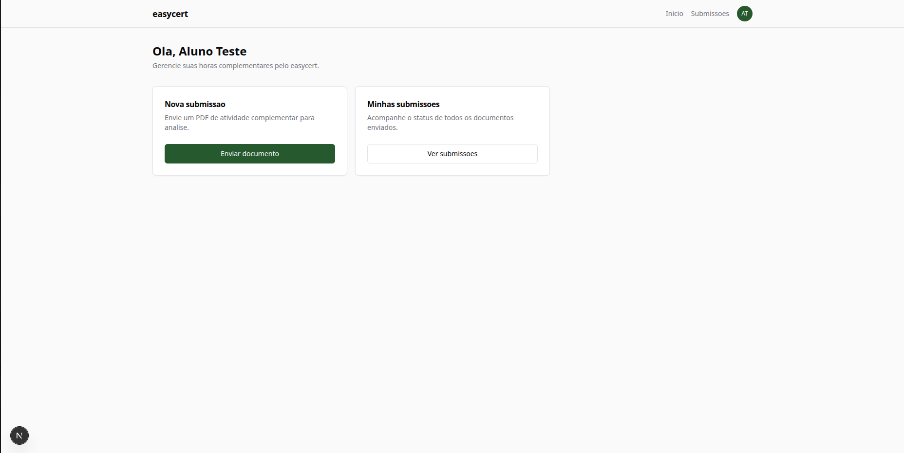
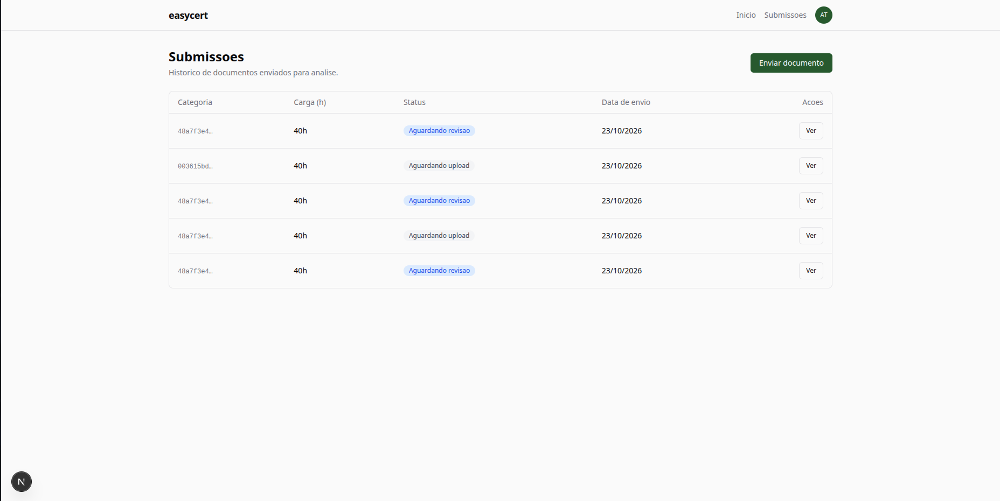

# TCC — Pré-banca (rascunho — reframe 2026-10-27)

Esqueleto dos 16 slides da pré-banca sob o reframe para emissão + validação de certificados. Formato compatível com o script `scripts/build-pre-banca.py` (dispatch por `## Slide N — ...`). Imagens dos slides 4, 10 e 11 são placeholders — arquivos a desenhar depois; se ausentes, o build loga aviso e segue.

Spec: [[superpowers/specs/2026-10-27-pre-banca-reframe-certificados-design]].

---

## Slide 1 — Capa

> **Desenvolvimento de uma Plataforma Web para Emissão e Validação de Certificados Acadêmicos, Baseada em Desenvolvimento Acelerado**
>
> Discente: Pedro Henrique Teixeira
> Orientador: Prof. Robson Leandro Carvalho Canato

## Slide 2 — Instituição

> GRADUAÇÃO EM CIÊNCIA DA COMPUTAÇÃO
> Faculdade Municipal Professor Franco Montoro — FMPFM

## Slide 3 — Introdução · Contextualização

- As **atividades complementares** são componente curricular obrigatório na educação superior brasileira (Diretrizes Curriculares Nacionais, CNE/CES).
- O **certificado** é o instrumento concreto que comprova essas atividades — tanto o que a **IES emite** (eventos próprios: palestras, oficinas, semanas acadêmicas) quanto o que o **aluno traz de fora** (cursos, voluntariado, representação estudantil).
- A integralização desses certificados em carga horária é **condição para colação de grau**.
- Em IES de pequeno e médio porte, a gestão do ciclo de vida do certificado — **emitir, receber, validar, consolidar** — permanece **manual**.

## Slide 4 — Problema · As-Is × To-Be

- **Duas pontas, uma dor comum:** falta de ciclo digital do certificado.
- Aluno **descobre lacunas no fechamento curricular** às vésperas da colação.


## Slide 5 — Pergunta de pesquisa

> _Substitui "Hipótese" do template de Muller — a pesquisa é aplicada, não hipotético-dedutiva._

- É possível **automatizar o ciclo de vida do certificado acadêmico** na FMPFM — **emissão** para eventos próprios e **validação** de certificados externos — por meio de uma plataforma web construída com **desenvolvimento acelerado em stack moderna**, **reduzindo latência e retrabalho** e mantendo níveis adequados de usabilidade para alunos e coordenadores?

## Slide 6 — Justificativa

- Digitalização de fluxos acadêmicos é vetor reconhecido de **ganho de eficiência e transparência** em secretarias (literatura de BPM/BPA em IES).
- A **ausência de emissão oficial** de certificados em eventos próprios de IES de pequeno/médio porte tira do aluno a prova material da própria formação — vazio documental com consequência direta no fechamento curricular.
- Frameworks modernos (NestJS, Next.js, Prisma, Postgres) permitem **protótipos funcionais em prazo acadêmico** sem abrir mão de qualidade técnica.
- Trabalhos correlatos cobrem **partes isoladas** do problema — faltam soluções **integradas** tratando emissão **e** validação sob o mesmo ciclo, com **avaliação formal de usabilidade**.

## Slide 7 — Objetivos · Geral

> **Objetivo Geral**
> Desenvolver e avaliar um protótipo de plataforma web para **emissão de certificados de eventos próprios** e **validação de certificados externos** no âmbito das atividades complementares, tomando como estudo de caso o curso de Ciência da Computação da FMPFM.

## Slide 8 — Objetivos · Específicos

- **Mapear** o fluxo vigente (As-Is) de **emissão** e de **recepção/validação** de certificados na FMPFM e definir a matriz de regras por categoria.
- **Prototipar** a arquitetura utilizando desenvolvimento acelerado com stack moderna (NestJS, Next.js, Prisma, PostgreSQL).
- **Implementar** os módulos de emissão (eventos, participantes, geração de PDF), recepção (submissão de certificados externos), avaliação (revisão pela coordenação, aplicação da matriz), consolidação (carga horária) e emissão de documentos oficiais.
- **Avaliar** o protótipo quanto à usabilidade (SUS) e ao desempenho operacional — latência As-Is × To-Be, medida separadamente para emissão e para validação.

## Slide 9 — Metodologia

- **Tipo de pesquisa:** aplicada, quanti-qualitativa, experimental, estudo de caso.
- **Fase 1 — Levantamento:** mapeamento As-Is das duas pontas (emissão e recepção), regulamento, requisitos funcionais e não funcionais.
- **Fase 2 — Modelagem:** schema Prisma, arquitetura em módulos, definição de papéis (aluno, coordenação).
- **Fase 3 — Prototipagem acelerada:** interfaces (Next.js) e automações (NestJS) em ciclos curtos.
- **Fase 4 — Avaliação:** usabilidade (SUS, 10 itens Likert; faixa ≥ 68 = acima da média) + medição de latência As-Is × To-Be em dois cenários (emissão de certificado em evento próprio; validação de certificado externo).

## Slide 10 — Arquitetura

- **Separação estrita `web ↔ api`:** interface não acessa banco; API não serve HTML.
- **Dois caminhos para o certificado**: um emitido pela FMPFM, outro trazido pelo aluno — convergem no mesmo ciclo de validação.


## Slide 11 — Fluxo caminho feliz da emissão

- Ramificações (reemissão, correção) tratadas no sistema mas fora deste slide.


## Slide 12 — Resultados preliminares

> _Qualificação — protótipo em andamento, SUS/As-Is ainda não executados._

- **Mapeamento As-Is da FMPFM concluído** — baseline documentado para a Fase 4.
- **Schema de dados modelado** em Prisma 6 (usuários, submissões, documentos, categorias, matriz, eventos, auditoria).
- **Backend NestJS 11** — 9 módulos; fluxo de **recepção e validação** ponta a ponta, com máquina de estados da submissão formalmente definida (`AWAITING_UPLOAD → PENDING → UNDER_REVIEW → APPROVED | REJECTED | CORRECTION_REQUESTED`).
- **Upload direto ao storage** via POST policy (RF-06).
- **Portal do aluno** (Next.js 15 + React 19): autenticação real, half-circle de progresso, consumo de `GET /categorias`.
- **Em desenvolvimento até a defesa:** módulo de **emissão** (eventos → geração de PDF → portal do aluno).
- 
- 

## Slide 13 — Cronograma

| Atividades | Ago | Set | Out | Nov |
|---|:-:|:-:|:-:|:-:|
| Levantamento de requisitos / regulamento | X | | | |
| Modelagem de dados e arquitetura | X | X | | |
| Prototipagem — recepção e validação | X | X | X | |
| Prototipagem — emissão de certificados | | | X | X |
| Testes de usabilidade (SUS) | | | | X |
| Medição As-Is × To-Be (emissão e validação) | | | | X |
| Escrita — Introdução e Fundamentação | X | | | |
| Escrita — Metodologia | | X | | |
| Escrita — Resultados e discussão | | | X | X |
| Considerações finais / revisão ABNT / preparação da banca | | | X | X |

## Slide 14 — Considerações parciais

- O mapeamento do As-Is confirmou **duas dores no ciclo de vida do certificado**: emissão ausente em eventos próprios da FMPFM e validação lenta de certificados externos.
- A opção por **stack moderna como "desenvolvimento acelerado"** se mostrou viável em prazo acadêmico — fluxo de recepção/validação entregue em 2 meses (9 módulos backend + portal do aluno).
- Decisões estruturantes consolidadas: separação estrita `web ↔ api`, `AuditLog` append-only, upload direto ao storage via POST policy.
- **Próximos passos até a defesa:** implementar o módulo de **emissão** (eventos → PDF → portal), executar SUS e medir As-Is × To-Be **nos dois cenários**.

## Slide 15 — Referências

Referências levantadas em 2026-10-23 para a pré-banca (Portaria 554/2019 destacada no reframe pela relevância à emissão oficial):

- BRASIL. Ministério da Educação. **Portaria nº 554, de 11 de março de 2019**. Dispõe sobre a emissão e o registro de diploma de graduação por meio digital pelas IES pertencentes ao Sistema Federal de Ensino. Diário Oficial da União: seção 1, Brasília, DF, 12 mar. 2019. Disponível em: https://www.in.gov.br/materia/-/asset_publisher/Kujrw0TZC2Mb/content/id/66544171/do1-2019-03-12-portaria-n-554-de-11-de-marco-de-2019-66543842. Acesso em: 23 out. 2026.
- BALDOW, Samuel Rodrigues et al. Low-Code e No-Code: democratizando o desenvolvimento de software. **REMUNOM: Revista Multidisciplinar do Nordeste Mineiro**, v. 11, n. 1, 2024. DOI: https://doi.org/10.61164/rmnm.v11i1.3032. Acesso em: 23 out. 2026.
- BRASIL. Ministério da Educação. Conselho Nacional de Educação. Câmara de Educação Superior. **Resolução CNE/CES nº 5, de 16 de novembro de 2016**. Institui as Diretrizes Curriculares Nacionais para os cursos de graduação na área da Computação. Diário Oficial da União: seção 1, Brasília, DF, 17 nov. 2016. Disponível em: https://abmes.org.br/arquivos/legislacoes/Res-CES-CNE-005-2016-11-16.pdf. Acesso em: 23 out. 2026.
- BROOKE, John. SUS: a "quick and dirty" usability scale. In: JORDAN, P. W. et al. (Ed.). **Usability Evaluation in Industry**. London: Taylor & Francis, 1996. p. 189-194.
- CARVALHO, Mariana Freitas Canielo de; AGANETTE, Elisângela Cristina; MACULAN, Benildes Coura Moreira dos Santos. BPM Acadêmico: uma metodologia para modelagem de processos em IES. **RDBCI: Revista Digital de Biblioteconomia e Ciência da Informação**, Campinas, v. 24, 2026. DOI: https://doi.org/10.20396/rdbci.v24i00.8680182. Disponível em: https://www.scielo.br/j/rdbci/a/K8JdxBsTTx6RdgsZgthSgCF/. Acesso em: 23 out. 2026.
- TOLEDO, Paulo Donizete Alves de; SIRQUEIRA, Tassio Ferenzini Martins. Horas complementares: um aplicativo de gestão de atividades acadêmicas. **Caderno de Estudos em Sistemas de Informação**, v. 8, n. 1, p. 1-12, 2021. DOI: https://doi.org/10.5281/zenodo.15042181. Disponível em: https://zenodo.org/records/15042181. Acesso em: 23 out. 2026.
- `[FALTA]` Regulamento oficial de horas complementares da FMPFM (quando obtido).

## Slide 16 — Obrigado

> **Obrigado!**
> Pedro Henrique Teixeira — ph.teixeira.ph2020@gmail.com

---

## Como regerar o arquivo .pptx

Pré-requisito único: `pip install --user python-pptx`.

Para gerar (ou regerar após editar este rascunho) a apresentação:

```bash
python scripts/build-pre-banca.py
```

O arquivo gerado é `~/Downloads/pre-banca.pptx`. O script preserva o visual do template `Muller_PreBanca_v2.pptx`, duplica dois slots a partir do layout do slide 9 (Metodologia) para acomodar Arquitetura e Fluxo, e roda uma verificação por diff rascunho × pptx no final.

Lacunas `[FALTA: ...]` ficam em branco no slide — rastreio em [[dominio/pendencias]]. Imagens placeholder dos slides 4/10/11 (V1/V2/V3) ficam ausentes até serem desenhadas — build loga aviso e segue, sem falhar.

**Spec:** [[superpowers/specs/2026-10-27-pre-banca-reframe-certificados-design]].

---

## Notas relacionadas

- [[tcc/visao-geral]] — identificação, objetivos e título do TCC.
- [[tcc/estrutura-artigo]] — estrutura canônica das 5 seções do artigo.
- [[tcc/metodologia]] — detalhamento do método (fases, SUS, As-Is × To-Be nos dois cenários).
- [[tcc/cronograma]] — plano temporal de 5 meses.
- [[tcc/rascunhos/01-introducao]] — rascunho da introdução.
- [[tcc/trabalhos-correlatos]] — material da seção 2 (impacta slide 15 Referências).
- [[tcc/rascunhos/pre-banca.backup-2026-10-27]] — backup pré-reframe.
